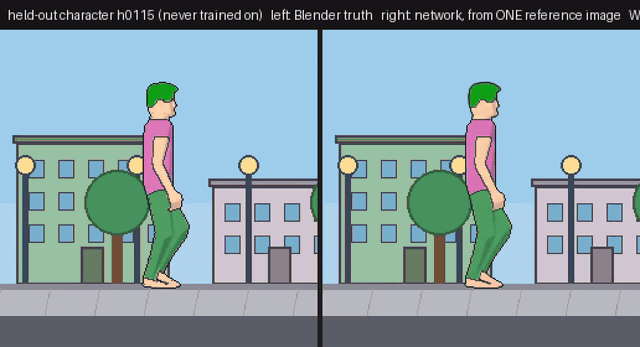
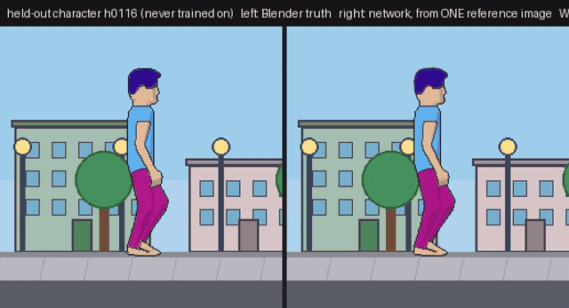
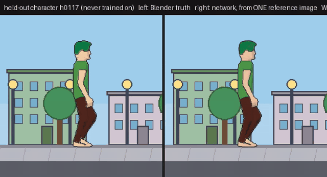
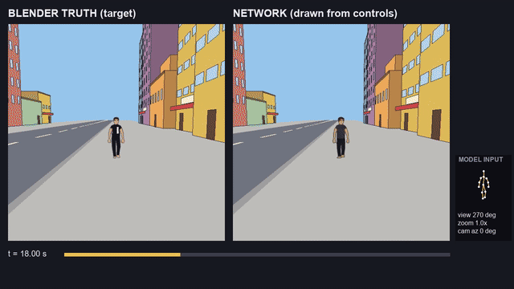
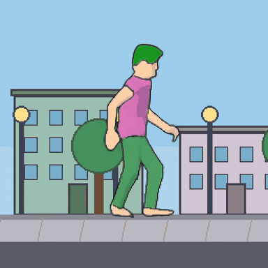

<p align="center"></p>

# Forward Flow: one-reference cartoon character renderer

A small network (6.3 M parameters) that draws a cartoon character in any pose from **one reference image** of that
character, plus 13 2-D joints per frame. It never sees the target frames.

The characters in the demos below were **held out**: the network never trained on them.

| h0115 | h0116 | h0117 |
|---|---|---|
|  |  |  |

Left half of each clip: Blender truth. Right half: the network, from ONE reference image. Full-quality MP4s are in
[media/](media/).

Each video runs a 20 s script: walk, run, turn around, walk back, jump, turn to the camera, wave, turn, run, jump.

## New: multi-angle model `crender_h5ma` and a one-minute hold-out test



Full video: [media/gen60_truth_vs_network.mp4](media/gen60_truth_vs_network.mp4). Left: Blender truth. Right: the network.
Same minute, same camera.

**The test.** One continuous minute of a character in a tuxedo-style outfit (black suit, white shirt front) that never
appears in the training set. The network gets **one** image of it (`examples/gen60_tux/ref.png`, side-on, idle). The
camera starts side-on, swings to face him, zooms in on his face and back out, then orbits through the front quarters, a
rear quarter and the rear. The joints and the view angle come from the Blender rig each frame (`examples/gen60_tux/`).
The street is a separate procedural scene renderer (perspective, 29 seeded buildings), not a learned model.

**The model.** Same architecture and recipe as `crender_h3y` (6.3 M parameters). The only change is the training data: a
multi-angle pack of 140 characters x 712 frames with continuous random view angles, mid-clip turns, and three view-angle
bands held out of training (45 +- 10, 225 +- 10 and the front, 270 +- 25 deg). Weights: `weights/crender_h5ma/` (plateau stop at
step 18,000). The view-angle input is the facing yaw: 0 = profile facing right, 90 = back, 180 = profile left,
270 = facing the camera.

Frozen gates, 25 held-out characters, test vs the side-trained control (same recipe, side-on data), all bands PASS
(`results/crender_h5ma/gate_bands_verdict.json`):

| view band (held-out characters) | colour error, test | control | alpha IoU, test | control |
|---|---|---|---|---|
| side | **8.95** | 16.05 | **0.965** | 0.919 |
| rear 90 | **11.90** | 15.90 | **0.967** | 0.931 |
| 45 (never trained) | **13.68** | 14.77 | **0.949** | 0.936 |
| 225 (never trained) | **17.38** | 24.72 | **0.928** | 0.880 |
| front 270 (never trained) | **23.00** | 26.79 | **0.888** | 0.850 |

The one-minute tuxedo shot (`results/crender_h5ma/gen60_*.json`), against the Blender truth with the same outline step as
training:

| | test | control |
|---|---|---|
| colour error inside the true figure, whole minute | **20.3** | 23.5 |
| alpha IoU, whole minute | **0.936** | 0.903 |
| colour error, second 1 -> second 60 | 14.1 -> 14.2 | 13.3 -> 15.1 |
| network time per frame, RTX 4090 | 0.95 ms batched (32), 2.9 ms single | |

Caveats for this result:
- **No drift by construction.** The renderer is stateless: every frame is drawn from (reference, joints, view angle)
  alone, so there is nothing to accumulate. The flat second-1 vs second-60 numbers confirm that; they are not evidence of
  a temporal model.
- **Visible misses.** The white shirt front is lost, the jacket comes out greyer than the truth, and the face is soft,
  worst in the zoom. The model reads the reference mostly as region colours, so small details of a new outfit do not
  transfer.
- **The front is still the hardest view** (23.0 vs 9.0 at the side), and the 45-degree band barely improved.
- **Pose and camera are given.** The motion and the view angle come from the Blender rig; the network draws pixels.
- **The control is unreleased.** It is the side-trained twin of this recipe (`crender_h4p`), used only for comparison.
- One training seed; the multi-angle pack builder is in `reproduce/multiangle/`, the street / compositor / demo in
  `reproduce/gen60/`.

## New: `crender_h5mac_all` weights with body-surface coordinates

`weights/crender_h5mac_all/` contains the latest fully trained cartoon-character renderer (6.30 M parameters). It
draws the same premultiplied RGBA image as the released character models and additionally predicts a three-channel
body-surface coordinate field, exposed after inference as `model.last_coords`. This supports parented visual objects,
such as shirt patterns, without changing the RGB/RGBA call site.

It was trained on all view angles for the 105 training characters, then evaluated on held-out characters. The gate is
stored beside the weights in `gate_ab_verdict.json`: the RGB error met the frozen non-regression bar in every view band;
body-coordinate L1 is also reported per band. Because all angles were included in training for this model, those bands
are not an unseen-angle generalization claim. The earlier `crender_h5ma` weights remain the released angle-held-out
model and should be used for that comparison.

## Scope of this release (read this first)

`crender_h3y` is ONE deliberately stateless rendering lane, not the complete Forward Flow system.

- Its forward path: reference RGBA + the current frame's 13 joints + facing yaw -> one RGBA frame.
- It was trained with gradient descent (AdamW).
- In this released experiment there is no recurrent state, prior-frame input, temporal attention, learned motion
  planner, or evolutionary optimisation.
- Temporal behaviour in the demos comes entirely from the joint sequence that drives it (Blender rig motion, or the
  recorded segments in the toy demo).

## Relation to broader Forward Flow research

Forward Flow is a factorized video system: persistent scene state, character-local motion state advanced over time,
separately learned renderers, and a deterministic compositor. The research codebase includes:
- temporal components: a motion-dynamics module with a declared cyclic gait clock (`ClockDyn`) that advances each
  character's state frame to frame;
- hybrid evolutionary-gradient components: detector banks found by MANTIS-style evolutionary search, with
  gradient-trained encoders and decoders around that frozen, evolved vocabulary.

Those components are **not included, measured, or claimed** by this character-renderer release. Do not infer them from
this repository's name or metrics, in either direction: the limits below say nothing against them, and the numbers
here say nothing for them.

## Try it

```bash
pip install -r requirements.txt
python try_it.py --example h0115                 # 20 s action script -> out/h0115.mp4
python try_it.py --example h0116 --recolor 0.33  # same motion, hue-rotated reference = a new-looking character
python toy_demo.py                               # random action script, rendered live by the network
python toy_demo.py --seed 7 --seconds 30         # reproducible; every run saves out/toy_seed<N>.script.json
python toy_demo.py --replay out/toy_seed7.script.json --save out/replay.mp4 --no_window
```



`toy_demo.py` (above: seed 7, first 12 s, network rendering only) draws a random, bounded script from the supported actions (Walk, Run, Jump, Idle, Wave, turns).
- It stitches recorded joint segments from `examples/action_library.json`, cross-fading 6 frames at every cut.
- The network renders every frame live; this is network rendering only, with no Blender truth.
- The same seed replays the same script deterministically. Rendered pixels can differ slightly across hardware and
  library versions (on one machine our replay test was byte-identical).
- Measured on an RTX 4090: **3.8-4.1 ms per frame (~250 fps)**, batch 1, fp32. CPU speed is not measured.

## What is claimed, and how it was checked

The renderer was trained on 115 procedural characters: palette and head-scale variants of one CC0 rigged human,
cel-shaded in Blender. It was evaluated on 25 characters it never saw. The gates were frozen before training. The bars
come from the data itself: truth vs. the same truth shifted by 1 px.

| Gate (held-out characters) | Bar | Model | Control |
|---|---|---|---|
| G1 shape: alpha soft IoU | >= truth-shifted-1px, and >= ref-paste + 0.10 | **0.976** | ref-paste (right look, no pose change) |
| G2 colour: RGB error inside the true figure (0-255) | <= truth-shifted-1px | **4.69** | |
| G3 identity is used: token-swap error >= 2x model | >= 9.4 | swap **47.4** | token-swap (right pose, wrong reference) |

All three pass (`results/gate.json`). G3 shows that the look comes from the reference image and is not memorised: give
the network another character's reference, and the output takes that character's colours.

The wave in the demos is planted: hips and legs are held while the upper body plays a captured wave. Foot-drift gate
(`results/wave_foot_gate.json`), frozen before rendering: truth ankle drift <= 1.0 px and rendered foot drift
p95 <= 2.0 px. Result: truth 0.0 px, rendered <= 0.13 px on all three characters. Identity drift over the 20 s, as
per-region colour error in 2 s windows, is in `results/drift.json`.

## Caveats (including points from an external review)

What the evidence here does and does not show:

- **Generalisation is narrow.** The 25 held-out characters are new palette and head-scale combinations of the same
  rig, the same proportions and the same cel style. This shows appearance transfer and pose-conditioned rendering
  inside one procedural family. It does not show generalisation to new character designs, proportions, clothing,
  accessories or art styles; no out-of-distribution rig has been tested.
- **The renderer does not animate.** It receives motion (joints); it renders, and does not plan or learn actions. Motion is supplied (rig joints, or re-sequenced recorded segments with mirroring
  and cross-fades in the toy demo). The renderer predicts pixels for that motion. 
- **The controls are basic.** Ref-paste, token-swap and the 1 px truth-shift bars show the pipeline works and that the
  reference is used. There are no competing baselines (smaller U-Net, conventional pose-to-image model, per-part colour
  transfer) and no ablations (no appearance CNN, no yaw input). So nothing here shows this architecture is necessary
  or better than alternatives.
- **The identity test is partly a colour test.** Characters differ mainly in palette, and the model reads a per-region
  reference palette (`ref_palette()` in `char_render.py`). The token-swap result (4.69 vs 47.4) shows appearance
  conditioning works. It is not evidence of a general identity representation.
- **The RGB error is measured inside the true silhouette only.** Colour drawn outside the figure is not penalised by
  that number; alpha IoU covers shape. It is not a full-image reconstruction score.
- **Robustness to joint noise is untested.** Training adds 0.3 px noise to target joints and 2 px to reference joints;
  the gate uses clean target joints. Performance under realistic pose-detection noise (1-8 px) has not been measured.
- **Single training run.** One published seed, 20,000 steps. Seed-to-seed variance is not reported. The training pack is not
  included (it is regenerated by `reproduce/make_blender_jobs2.py`), and dependency versions are ranges, not pins.
- **Speed is network-only.** About 4 ms/frame on an RTX 4090, from prepared joints, excluding pose preparation and video
  encoding. CPU speed is not measured, and there is no quality-matched speed comparison.
- **Viewpoints are mostly side-on** (`crender_h3y`). Facing the camera, the face comes out blank and the waving arm goes soft. See `crender_h5ma` above for the multi-angle model.
- **Toy demo motion is re-sequenced recorded joints.** Mirrored segments wave with the other hand.
- **Format:** 256 px output, cel-shaded only.

## Reproduce

- `forward_flow/char_render.py` holds the model, training (`train`), the gate (`gate`) and the calibration
  (`calibrate-shift`).
- `reproduce/` holds the Blender 5.1.2 pack builder (`make_blender_jobs2.py`, `blender/render_batch2.py`, mocap
  retarget), outlines (`post_outline.py`), the release demo pack (`make_release_demo.py`) and the truth-vs-network
  videos (`video_demo.py`).
- Training run: 20,000 steps, batch 16, plateau stop; 25,547 training frames; see `weights/crender_h3y/train.json`.
- The training pack itself (about 36 k rendered frames) is not included. It is regenerated by `make_blender_jobs2.py`
  (seed 20261017, 140 characters, 25 held out) with Blender and the asset below.

## Credits and licences

- Character asset: "Animated Human" by Quaternius, CC0 1.0 (`reproduce/QUATERNIUS_LICENSE.txt`).
- Wave motion: CMU Graphics Lab Motion Capture Database, subject 141 trial 16. "The data used in this project was obtained
  from mocap.cs.cmu.edu. The database was created with funding from NSF EIA-0196217." Terms: THIRD_PARTY_NOTICES.md.
- Code: MIT. Original weights, results and logo: CC BY 4.0. Examples and demo videos contain CMU-derived motion and
  are covered by THIRD_PARTY_NOTICES.md, not CC BY. See LICENSE.
